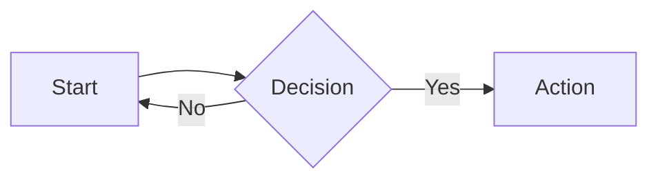

# slidev-theme-kskwtnk

[](https://www.npmjs.com/package/slidev-theme-kskwtnk)

A (...) theme for [Slidev](https://github.com/slidevjs/slidev).

<!--
  Learn more about how to write a theme:
  https://sli.dev/guide/write-theme.html
--->

<!--
  run `npm run dev` to check out the slides for more details of how to start writing a theme
-->

<!--
  Put some screenshots here to demonstrate your theme

  Live demo: [...]
-->

## Install

Add the following frontmatter to your `slides.md`. Start Slidev then it will prompt you to install the theme automatically.

<pre><code>---
theme: <b>kskwtnk</b>
---</code></pre>

Learn more about [how to use a theme](https://sli.dev/guide/theme-addon#use-theme).

## Layouts

The `two-cols`, `two-cols-header`, `three-cols`, `three-cols-header`, `two-by-two`, and `two-by-two-header` layouts have transparent content panels by default.
Set `panelBackground: true` in a slide's frontmatter to give every content panel a white background with horizontal (`px-5`) and vertical (`py-4`) padding:

```yaml
---
layout: two-cols-header
panelBackground: true
---
```

Omit `panelBackground` or set it to `false` for transparent panels without padding.
This option changes panel backgrounds and padding; slide backgrounds, gaps between panels, and header styling stay the same.
The existing `class` prop still applies to every content panel, and `layoutClass` applies to the whole layout.

## Components

This theme provides the following components:

> TODO:

## Mermaid

Mermaid code blocks are rendered with [beautiful-mermaid](https://github.com/lukilabs/beautiful-mermaid) using Slidev's [custom renderer setup](https://sli.dev/custom/config-mermaid-renderer).
Use Slidev 52.20.1 or later when using this theme.

````md

````

Colors, font, and background use beautiful-mermaid defaults. Set `{transparent: true}` on a block to remove its background.
Diagram options such as `{scale: 0.8}` still work; beautiful-mermaid options such as `{bg: '#ffffff', fg: '#292524'}` can also be set per block.

beautiful-mermaid supports flowcharts, state, sequence, class, ER, and XY charts.
It does not support all Mermaid syntax or standard Mermaid theme settings; diagrams such as pie and Gantt charts are not supported by this renderer.

## Contributing

- `npm install`
- `npm run dev` to start theme preview of `example.md`
- Edit the `example.md` and style to see the changes
- `npm run export` to generate the preview PDF
- `npm run screenshot` to generate the preview PNG
