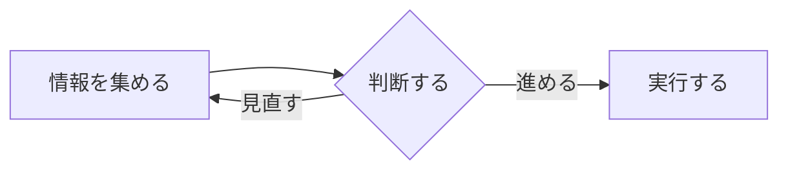
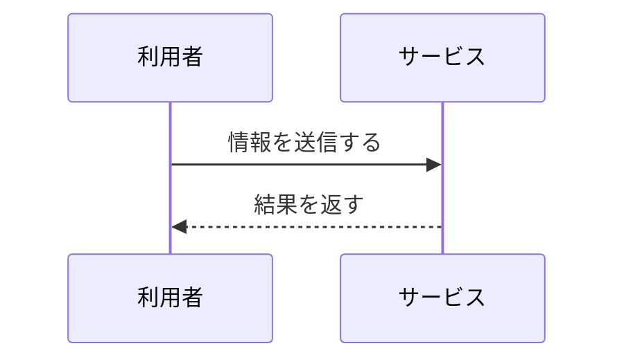

# kskwtnkによるSlidevテーマ

これは`layout: cover`です

---
layout: cover
---

タイトルの上にテキストがある場合はこのように表示されます

# 長めのタイトルの場合はこのように表示されます

これは`layout: cover`です

本文が複数行になる場合はこのように表示されます

---
layout: intro
---

::left::

::right::

# 綿貫 佳祐

- 職種や肩書き
- プロフィールや略歴
- 題材やイベントにあわせた一言

SNS: @kskwtnk

---
layout: section
---

# セクションタイトルのレイアウト

---
layout: section
---

# 長めのセクションタイトルの場合はこのように表示されます

テキストが追加される場合はこのように表示されます

---
layout: default
---

# デフォルトのレイアウト

通常の文章はこのように表示されます

あのイーハトーヴォのすきとおった風、夏でも底に冷たさをもつ青いそら、うつくしい森で飾られたモリーオ市、郊外のぎらぎらひかる草の波

改行を含めた文章は、このように余白をともなって表示されます

<!-- prettier-ignore -->
___

罫線はこのように表示されます

---
layout: default
---

# デフォルトのレイアウト

リストはこのように表示されます

1. 順序ありリスト
   1. ネストされた順序ありリスト
      1. 更にネストされた順序ありリスト
1. 順序ありリスト

- 順序なしリスト
  - ネストされた順序なしリスト
    - 更にネストされた順序なしリスト
- 順序なしリスト

---
layout: default
---

# テーブルの表示

表組みはこのように表示されます

| 項目 | 内容 | 状態 |
| --- | --- | --- |
| 見出し | スライド全体の主題を短く示します | 必須 |
| 本文 | 説明や補足情報を配置します | 任意 |
| 図版 | 画像やチャートで理解を助けます | 任意 |

---
layout: two-cols
# 各領域の背景・paddingなし（未指定時も同じ）
panelBackground: false
---

# 2カラムのレイアウト

1. 順序ありリスト
   1. ネストされた順序ありリスト
1. 順序ありリスト
1. 順序ありリスト

::right::

# 右カラム

- 順序なしリスト
  - ネストされた順序なしリスト
- 順序なしリスト
- 順序なしリスト

---
layout: two-cols
# 各領域に白背景・paddingあり
panelBackground: true
---

# 2カラムのレイアウト

1. 順序ありリスト
   1. ネストされた順序ありリスト
1. 順序ありリスト
1. 順序ありリスト

::right::

# 右カラム

- 順序なしリスト
  - ネストされた順序なしリスト
- 順序なしリスト
- 順序なしリスト

---
layout: two-cols-header
# 各領域の背景・paddingなし（未指定時も同じ）
panelBackground: false
---

# ヘッダー付き2カラムのレイアウト

上部にスライド全体の見出しや導入文を置き、その下を左右に分けられます

::left::

1. 順序ありリスト
   1. ネストされた順序ありリスト
1. 順序ありリスト
1. 順序ありリスト

::right::

- 順序なしリスト
  - ネストされた順序なしリスト
- 順序なしリスト
- 順序なしリスト

---
layout: two-cols-header
# 各領域に白背景・paddingあり
panelBackground: true
---

# ヘッダー付き2カラムのレイアウト

上部にスライド全体の見出しや導入文を置き、その下を左右に分けられます

::left::

1. 順序ありリスト
   1. ネストされた順序ありリスト
1. 順序ありリスト
1. 順序ありリスト

::right::

- 順序なしリスト
  - ネストされた順序なしリスト
- 順序なしリスト
- 順序なしリスト

---
layout: three-cols
# 各領域の背景・paddingなし（未指定時も同じ）
panelBackground: false
---

# 3カラムのレイアウト

1. 順序ありリスト
   1. ネストされた順序ありリスト
1. 順序ありリスト
1. 順序ありリスト

::center::

# 中央カラム

- 順序なしリスト
  - ネストされた順序なしリスト
- 順序なしリスト
- 順序なしリスト

::right::

# 右カラム

通常の文章はこのように表示されます

短い説明や補足を並べて比較できます

---
layout: three-cols
# 各領域に白背景・paddingあり
panelBackground: true
---

# 3カラムのレイアウト

1. 順序ありリスト
   1. ネストされた順序ありリスト
1. 順序ありリスト
1. 順序ありリスト

::center::

# 中央カラム

- 順序なしリスト
  - ネストされた順序なしリスト
- 順序なしリスト
- 順序なしリスト

::right::

# 右カラム

通常の文章はこのように表示されます

短い説明や補足を並べて比較できます

---
layout: three-cols-header
# 各領域の背景・paddingなし（未指定時も同じ）
panelBackground: false
---

# ヘッダー付き3カラムのレイアウト

上部にスライド全体の見出しや導入文を置き、その下を3列に分けられます

::left::

1. 順序ありリスト
   1. ネストされた順序ありリスト
1. 順序ありリスト
1. 順序ありリスト

::center::

- 順序なしリスト
  - ネストされた順序なしリスト
- 順序なしリスト
- 順序なしリスト

::right::

通常の文章はこのように表示されます

短い説明や補足を並べて比較できます

---
layout: three-cols-header
# 各領域に白背景・paddingあり
panelBackground: true
---

# ヘッダー付き3カラムのレイアウト

上部にスライド全体の見出しや導入文を置き、その下を3列に分けられます

::left::

1. 順序ありリスト
   1. ネストされた順序ありリスト
1. 順序ありリスト
1. 順序ありリスト

::center::

- 順序なしリスト
  - ネストされた順序なしリスト
- 順序なしリスト
- 順序なしリスト

::right::

通常の文章はこのように表示されます

短い説明や補足を並べて比較できます

---
layout: two-by-two
# 各領域の背景・paddingなし（未指定時も同じ）
panelBackground: false
---

## 左上

本文は左上に表示されます

::top-right::

## 右上

右上の領域です

::bottom-left::

## 左下

左下の領域です

::bottom-right::

## 右下

右下の領域です

---
layout: two-by-two
# 各領域に白背景・paddingあり
panelBackground: true
---

## 左上

本文は左上に表示されます

::top-right::

## 右上

右上の領域です

::bottom-left::

## 左下

左下の領域です

::bottom-right::

## 右下

右下の領域です

---
layout: two-by-two-header
# 各領域の背景・paddingなし（未指定時も同じ）
panelBackground: false
---

# ヘッダー付き2行2列のレイアウト

::top-left::

## 左上

左上の領域です

::top-right::

## 右上

右上の領域です

::bottom-left::

## 左下

左下の領域です

::bottom-right::

## 右下

右下の領域です

---
layout: two-by-two-header
# 各領域に白背景・paddingあり
panelBackground: true
---

# ヘッダー付き2行2列のレイアウト

::top-left::

## 左上

左上の領域です

::top-right::

## 右上

右上の領域です

::bottom-left::

## 左下

左下の領域です

::bottom-right::

## 右下

右下の領域です

---
layout: center
---

# センター表示 見出しだけ

---
layout: center
---

# センター表示

見出しのテキスト

プラスして、通常のテキスト

---
layout: center
---

# センター表示

- 見出しのテキストに加えて
- 順序無しリストのテキストも
- 一緒に表示

---
layout: image
---

---
layout: default
---

# Mermaidの描画

---
layout: default
---

# シーケンス図の描画

